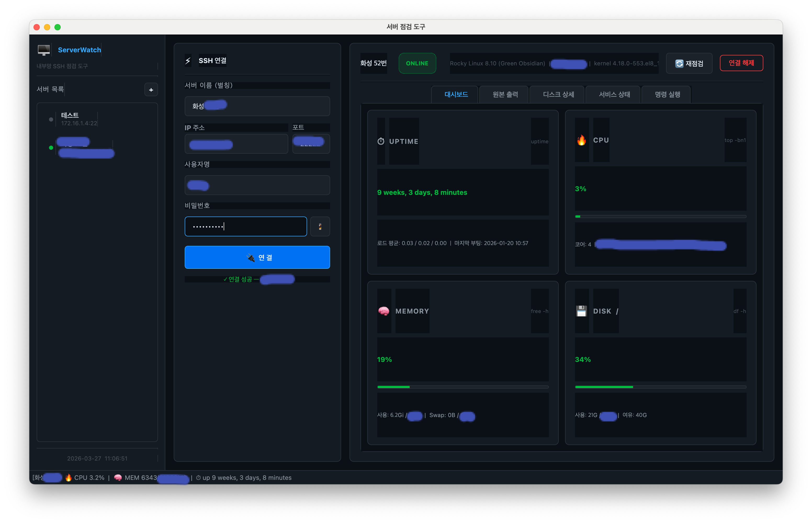

# ServerWatch

내부망 Linux 서버를 SSH로 점검하는 데스크톱 모니터링 도구.



## 주요 기능

- **SSH 원격 연결** — 서버 목록 저장/관리, 비밀번호 인증
- **대시보드** — Uptime, CPU, Memory, Disk 사용률을 게이지 카드로 시각화
- **원본 출력** — `uptime`, `top`, `free -h`, `df -h` 원본 텍스트 확인
- **디스크 상세** — 파티션별 용량/사용률 테이블
- **서비스 상태** — `ese@*` 서비스, PostgreSQL, Nginx 상태 조회
- **명령 실행** — 연결된 서버에 직접 셸 명령 전송

## 기술 스택

| 구분 | 내용 |
|------|------|
| 언어 | Python 3 |
| GUI | PyQt5 |
| SSH | paramiko |
| 패키징 | PyInstaller |

## 실행

```bash
# 의존성 설치
pip install -r requirements.txt

# 실행
python server_monitor.py
```

## macOS 빌드

```bash
chmod +x build_mac.sh
./build_mac.sh
```

`dist/ServerWatch` 실행 파일 또는 `dist/ServerWatch.app` 이 생성된다.

## 서버 목록 저장

서버 정보는 `~/.server_monitor_hosts.json`에 자동 저장된다.
